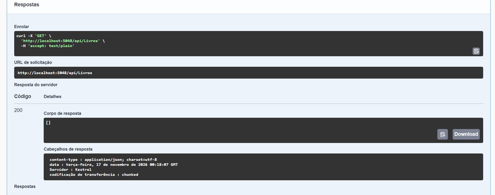

# Sistema Biblioteca - API C# | .NET 8

API REST para gerenciamento de livros desenvolvida em C# com .NET 8, como parte do meu portfólio para vagas de Desenvolvedor Back-End Júnior.

## 🚀 Tecnologias
- C# 12
- .NET 8 (ASP.NET Core Web API)
- Swagger / OpenAPI
- Persistência em memória (List) + JSON

## 📚 Funcionalidades
- `GET /api/Livros` - Lista todos os livros (200 OK)
- `POST /api/Livros` - Cadastra novo livro

## 📸 Prova funcionando - Swagger 200 OK



## 🐛 Desafio resolvido
Swagger estava retornando 404 por conflito com o pacote `Microsoft.AspNetCore.OpenApi`. Removi o pacote e reconfigurei o `Program.cs` para usar `AddEndpointsApiExplorer()` + `AddSwaggerGen()`. Agora `GET /api/Livros` retorna `200 OK []`.

## ▶️ Como rodar
```bash
cd BibliotecaApi
dotnet restore
dotnet run
# Abrir http://localhost:5048/swagger
